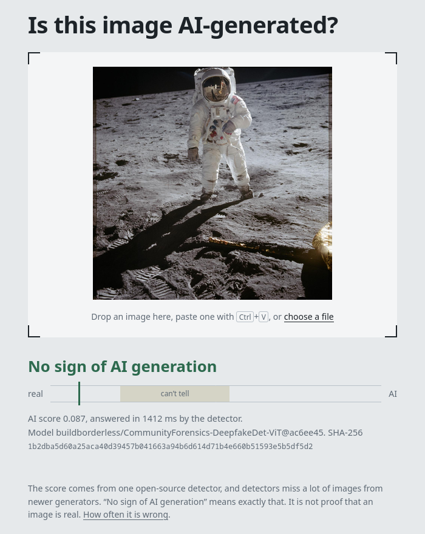
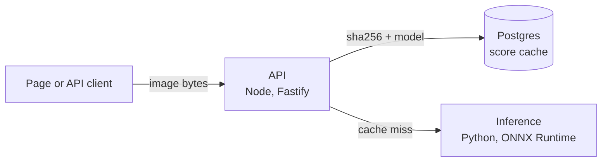

# AI media verification

Check whether an image is AI-generated. Drop it on the page, paste a screenshot, or POST
the bytes to the API, and get back a calibrated probability and one of three verdicts:
likely AI, can't tell, or no sign of AI.



On a 4-core laptop CPU a new image takes about 0.6 seconds, nearly all of it model time, and an
image anyone has checked before comes back in under 10 ms. The detector separates AI-generated
from real images well on recent generators (AUROC 0.916) but catches only about half of them,
so "no sign of AI" is not proof of anything. The numbers and their caveats are below.

## How it works



The API hashes the uploaded bytes and looks the hash up in Postgres. On a miss it sends the
image to the inference service, which decodes it, preprocesses it the way the model was
trained, and returns the raw logit from
[CommunityForensics ViT](https://huggingface.co/buildborderless/CommunityForensics-DeepfakeDet-ViT),
a ViT-Small trained on images from 4,803 generators. The API stores the logit, calibrates it
into a probability and maps that onto the verdict bands.

Choices worth knowing about:

- **The server hashes what it received.** Taking a URL and a client-computed hash instead
  would let a client attach a verdict to an image it never sent, and would turn the server
  into a fetcher for internal addresses. Uploading the bytes avoids both.
- **The cache stores raw logits.** Calibration and thresholds are applied on the way out, so
  refitting them never invalidates a cached row. Rows are keyed by model revision as well as
  hash, and the API refuses answers from any model other than the one its calibration was
  fitted for.
- **Identical uploads in flight share one model call.** A viral image arrives many times
  before the first result is cached; the later requests wait on the first one.
- **One model call at a time.** ONNX Runtime already spreads a single call across every core
  it is given, so concurrent calls only slow each other down. The service tracks requests in
  progress and answers 503 with `Retry-After` past a limit instead of queueing forever.
- **Large JPEGs are decoded at reduced scale.** libjpeg can decode at 1/2, 1/4 or 1/8 size,
  and asking for at least the model's resize target cut decode and preprocessing of a 12 MP
  photo from 390 ms to 74 ms. On 400 test images the AUROC was the same with and without it
  (0.923 against 0.920).
- **fp32, not int8.** The quantized export was only about 13% faster on this CPU, and its
  verdict differed from the full model's on 2 to 3 of the 48 test images compared.
- **The model revision is pinned and baked into the image.** The upstream repo has had its
  weights replaced in place before, and the container never downloads anything at runtime.
- **If Postgres goes down, requests still get answered**, just without the cache. At startup
  the API waits for Postgres but not for the detector, so cached answers keep working while
  the detector restarts.

Every response carries a `Server-Timing` header (`cache`, `decode`, `wait`, `model`), so
the browser's network panel shows where the time went.

## Speed

Measured with [apps/api/scripts/bench.ts](apps/api/scripts/bench.ts) against
`docker compose up` on an AMD Ryzen 5 3500U, a 4-core 15 W laptop chip, while other work kept the
load average between 5 and 7. Treat these as pessimistic.

Ordinary photos (0.5 and 1.6 MP JPEGs), 100 requests per row:

| Requests                   | p50     | p95     | p99     | Throughput |
| -------------------------- | ------- | ------- | ------- | ---------- |
| New image, one at a time   | 650 ms  | 853 ms  | 912 ms  | 1.5/s      |
| New images, four at a time | 2965 ms | 3182 ms | 3246 ms | 1.3/s      |
| Seen image, one at a time  | 6 ms    | 10 ms   | 12 ms   | 153/s      |
| Seen image, 32 at a time   | 56 ms   | 327 ms  | 354 ms  | 239/s      |

Mixed uploads (those two, a 0.9 MP PNG and a 45 MP, 9.7 MB phone-size JPEG), 60 requests per
row:

| Requests                   | p50     | p95     | p99     | Throughput |
| -------------------------- | ------- | ------- | ------- | ---------- |
| New image, one at a time   | 581 ms  | 815 ms  | 924 ms  | 1.6/s      |
| New images, four at a time | 2153 ms | 2572 ms | 2795 ms | 1.8/s      |
| Seen image, one at a time  | 7 ms    | 47 ms   | 54 ms   | 65/s       |
| Seen image, 32 at a time   | 321 ms  | 650 ms  | 713 ms  | 68/s       |

From `Server-Timing`, a new image spends 550 to 1,000 ms in the model, 25 to 30 ms decoding an
ordinary JPEG, 60 to 125 ms decoding the PNG and 180 to 330 ms decoding the 45 MP JPEG. The cache
lookup takes about 1 ms. New images go through the model one at a time, so concurrency does not
raise their throughput, it only lines them up. Seen images are limited by moving the bytes, which
is why the 9.7 MB file drags the second table down.

## Accuracy

Scored on [OpenFake](https://huggingface.co/datasets/ComplexDataLab/OpenFakeTiny) through the
same code path the service runs. Calibration and thresholds were fitted on the validation split
and then frozen.

| Images                                        | AUROC | Likely AI right | No sign right | AI caught |
| --------------------------------------------- | ----- | --------------- | ------------- | --------- |
| Test split, mostly 2025 and 2026 generators   | 0.916 | 96.1%           | 80.9%         | 52.2%     |
| The same images, recompressed like a chat app | 0.851 | 93.3%           | 75.8%         | 40.9%     |
| Posted to Reddit, mostly video frames         | 0.747 | 94.8%           | 33.9%         | 44.7%     |

The detector this project used before scored 0.682 AUROC on the same test split. When this one
says likely AI it is usually right. When it finds nothing, that means much less, especially on
a feed where most images are generated. Its worst blind spot is Flux.2 klein, which it catches
6.8% of the time.

The full write-up, with per-generator results and what the scores mean, is in
[docs/evaluation.md](docs/evaluation.md).

## Running it

```sh
docker compose up --build
```

Then open http://localhost:3000. The first build downloads the model (about 90 MB) into the
inference image.

From the command line:

```sh
curl --data-binary @photo.jpg -H 'content-type: image/jpeg' localhost:3000/api/v1/verify
```

```json
{
  "sha256": "24bf4ce093822101801f5ba3cad3f84525a5c6a42927b0a29579581c13c691ce",
  "verdict": "likely_real",
  "aiProbability": 0.0871,
  "thresholds": { "ai": 0.541, "real": 0.212 },
  "model": "buildborderless/CommunityForensics-DeepfakeDet-ViT@ac6ee45",
  "cached": false
}
```

Errors come back as `{ "error": { "code", "message" } }`:

| Status | Code                                    | When                                      |
| ------ | --------------------------------------- | ----------------------------------------- |
| 400    | `empty_body`                            | no bytes were sent                        |
| 413    | `image_too_large`                       | over 20 MB, or over 40 megapixels decoded |
| 415    | `unsupported_media_type`                | the content type is not `image/*`         |
| 422    | `invalid_image`                         | not a JPEG, PNG, WebP, GIF or AVIF image  |
| 429    | `rate_limited`                          | more than 30 checks a minute from one IP  |
| 502    | `detector_mismatch`, `detector_error`   | wrong detector model, or it failed        |
| 503    | `detector_busy`, `detector_unavailable` | the detector is saturated or down         |
| 504    | `detector_timeout`                      | the detector took longer than 15 s        |

## Configuration

The API reads these from the environment. Defaults are in
[apps/api/src/config.ts](apps/api/src/config.ts).

| Variable                                     | Default                    |                                 |
| -------------------------------------------- | -------------------------- | ------------------------------- |
| `DATABASE_URL`                               | required                   |                                 |
| `INFERENCE_URL`                              | `http://localhost:8000`    |                                 |
| `INFERENCE_TIMEOUT_MS`                       | `15000`                    |                                 |
| `MAX_IMAGE_BYTES`                            | `20971520`                 |                                 |
| `RATE_LIMIT_PER_MINUTE`                      | `30`                       | per client IP, held in memory   |
| `TRUST_PROXY`                                | `false`                    | set only behind a reverse proxy |
| `DETECTOR_MODEL`                             | `…DeepfakeDet-ViT@ac6ee45` | what the calibration is for     |
| `CALIBRATION_SLOPE`, `CALIBRATION_INTERCEPT` | `0.4065`, `1.5623`         | fitted on the validation split  |
| `AI_THRESHOLD`, `REAL_THRESHOLD`             | `0.541`, `0.212`           | fitted on the validation split  |

The inference service takes `INFERENCE_THREADS` (physical cores, default 4), `MAX_PENDING`
(default 8), `MAX_BODY_BYTES` and `MAX_IMAGE_PIXELS`.

## Development

API, with the inference service running:

```sh
docker run -d --name verify-pg -p 127.0.0.1:5432:5432 \
  -e POSTGRES_PASSWORD=postgres -e POSTGRES_DB=verify postgres:17-alpine
docker exec verify-pg createdb -U postgres verify_test

pnpm install
cp .env.example .env
pnpm --filter api dev
pnpm test
pnpm lint && pnpm typecheck
```

Inference:

```sh
cd apps/inference
python -m venv .venv && . .venv/bin/activate
pip install -r requirements-dev.txt
uvicorn app.main:create_app --factory --port 8000
pytest
```

The tables in [docs/evaluation.md](docs/evaluation.md) regenerate from the committed scores
with `python -m eval.report`. Rescoring from scratch downloads about 3 GB of OpenFake; the
commands are listed there.

Benchmark:

```sh
RATE_LIMIT_PER_MINUTE=1000000 docker compose up -d
cd apps/api
node scripts/bench.ts ~/photo.jpg ~/render.png --requests 60
```

## Not done

- A browser extension, so an image on any page can be checked with a right click.
- Matching near-duplicates. The cache only hits on identical bytes, so a recompressed copy
  of a known image goes back through the model.
- Shared rate limiting. The limiter lives in the API's memory, which is correct for one
  instance and too generous for several.
- A deployment. This runs locally with Docker Compose.

## License

MIT, see [LICENSE](LICENSE). The detector weights are MIT as well. OpenFake is CC BY-NC 4.0,
so only scores derived from it are in this repository, not its images.
